# 夜間作業レポート（2026年10月14日夜〜15日朝）

おはようございます。ご指示どおり、確認を待たずに朝まで自律的に進めました。結論から申し上げます。

**3人分の人生を、最初から最後まで通しで遊べる試作版ができました。** 統計にもとづく死亡・進学・就職・結婚・年金の判定、出来事862件、決断21種類、最後の画面（死亡記録・生涯年収・年金・生存曲線・人生地図・共有カード）まで動きます。画面の品質チェックは10周回しました。最後の独立した講評は、デザイン8.5、使いやすさ8.0、独創性8.5、内容8.5（総合8.4）です。

---

## 1. できたこと

| フェーズ | 成果 | 場所 |
|---|---|---|
| 1. 統計の追加調査 | 死と病気、戦争、家と家族、仕事、暮らしとお金、子ども、名前、1930〜40年生まれの年金、沖縄（F章）。沖縄の扱いを決めた | docs/03_必要な統計データ.md、docs/01_コンセプト.md |
| 2. 素材カタログ | 出来事のデータ形式（JSONスキーマ）、8カテゴリ、目標件数、情報源 | docs/04_素材カタログ.md |
| 3. 素材の収集 | **862件**（戦争199、全国94、制度80、都道府県243、暮らし・慣習113、文化89、仕事44）。47都道府県すべて。年齢帯ごとに書き分け。確かめた割合は89.6%（772件） | data/events/ |
| 4. 統計の加工 | 死亡率（1930〜2070年、男女・各歳）、出生数（全国・都道府県）、性比、結婚、進学率、失業率・求人倍率、賃金、年金、物価、産業別就業者。加工スクリプトで再現できる | data/stats/、scripts/build_*.py |
| 5. シミュレーションの中核 | 1年の進め方、毎年の死亡判定、状態の数値、お金、家族、決断、ひと息、年金。実験室テスト | src/sim/、tests/ |
| 6. 物語 | 決断21種類。3人とも生きていて3つとも違う結果になる場面を**32個**確認。最後の画面まで | src/sim/decisions.ts、docs/05_同じ選択と3つの結果.md |
| 7. 画面とデザイン | 3つの時代を書体・縁・質感・記号で描き分け（活版と紙／ブラウン管とプリクラ／令和のフラット）、年代ごとの町並み、スマホ主・PC対応、ダークモード、控えめな動き、効果音（初期は消音）、Canvas の共有カード | src/main.ts、src/ui/、src/styles/ |
| 8. 品質チェック | 10周。3周目までは自己採点、4周目からは別のエージェントの独立した講評で採点 | docs/品質チェック.md |

### 実験室の結果（シミュレーションが統計と合うか）

3,000組（9,000人）を走らせた結果です（`npm test`）。

| 生まれ年 | 平均の死亡年齢 | 生命表から計算した平均寿命 | 高校以上 | 大卒 | 結婚 | 生涯年収（今の価値） | 年金の月額（今の価値） |
|---|---|---|---|---|---|---|---|
| 1930〜45年 | 63.3歳 | 66.7歳 | 59% | 17% | 76% | 7,430万円 | 13.7万円 |
| 1960〜75年 | 84.5歳 | 84.4歳 | 96% | 37% | 83% | 1億5,311万円 | 11.8万円 |
| 1990〜2005年 | 88.1歳 | 87.9歳 | 99% | 57% | 81% | 2億2,127万円 | 18.1万円 |

（自動のおまかせで選んだ場合の平均。大卒の割合は「大学に行きたい」を選ぶことが多いぶん、実際の進学率より高めに出ます。生涯年収と年金は男女・就業の有無をすべて含む平均で、2026年より先は推計）

1960年以降の生まれは、生命表と±1歳以内で合います。1930〜45年生まれが3歳ほど短いのは、生命表の1944〜46年が補間で戦争の死亡を含まず、ゲームでは空襲・沖縄戦・原爆などの出来事で死亡を足しているためです（意図どおり）。乳児死亡の割合も生命表の0歳の死亡率と合っています。

## 2. 遊び方（ローカルでの起動）

```bash
git fetch origin claude/awesome-gates-1wrnmu
git checkout claude/awesome-gates-1wrnmu
npm install
npm run dev          # http://localhost:5173/ を開く
```

- テスト：`npm test`（実験室を含む11件）
- 本番用の書き出し：`npm run build`（dist/ に静的サイト。Cloudflare Pages にそのまま置けます）
- 画面の確認用の直接表示：`/?demo=life&age=30`、`/?demo=end`、`/?demo=birth` など（seed も指定できます）
- スクリーンショット：`npm run build && npx vite preview --port 4173 &` のあと `node scripts/screenshots.mjs`
- 通しで遊ぶテスト：同じく preview を起動して `node scripts/e2e.mjs`

## 3. 品質チェックの最終点数

| 周 | 採点者 | デザイン | 使いやすさ | 独創性 | 内容 |
|---|---|---|---|---|---|
| 1 | 自分 | 7 | 7 | 8 | 8 |
| 2 | 自分 | 8 | 8 | 8 | 8 |
| 3 | 自分 | 8 | 8 | 8.5 | 8 |
| 4 | 独立した講評 | 6.5 | 5.5 | 7.5 | 8.0 |
| 5 | 独立した講評 | 7.0 | 6.5 | 7.5 | 8.0 |
| 6 | 独立した講評 | 7.5 | 7.0 | 8.0 | 8.0 |
| 7 | 独立した講評 | 7.5 | 7.5 | 8.0 | 8.5 |
| 8 | 独立した講評 | 8.0 | 7.5 | 8.0 | 8.5 |
| 9 | 独立した講評 | **8.0** | **8.0** | **8.0** | **8.5** |
| 10（仕上げ後） | 独立した講評 | **8.5** | **8.0** | **8.5** | **8.5** |

自己採点は甘くなりがちだったため、4周目から別のエージェントに審査員の立場で採点してもらいました。最初の独立講評は自己採点より1〜2点低く、そこから指摘を1つずつ直しました。

| 項目 | 結果 |
|---|---|
| Lighthouse（タイトル、モバイル） | 性能98、アクセシビリティ100、ベストプラクティス100、SEO100 |
| Lighthouse（人生の画面） | 性能86〜96、アクセシビリティ100、ベストプラクティス100 |
| 横スクロール | なし（主要11画面×スマホ・PC） |
| 通しで遊ぶテスト | タイトル→ガチャ→母子手帳→人生（決断・ひと息）→走馬灯→最後の画面。エラー0 |

人生の画面と最後の画面の性能の点が低めなのは、確認用の直接表示（`?demo=`）で、読み込み直後に何十年分も計算するためです。実際の遊び方では計算は1年ずつ進み、出来事のデータはガチャのあいだに読み込まれます。

### スクリーンショット

| スマホ | PC |
|---|---|
| 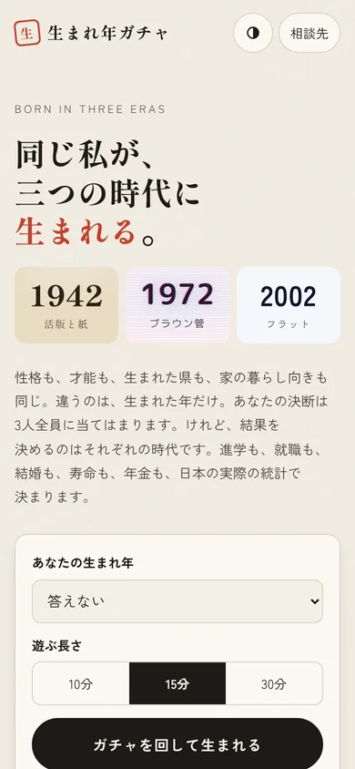 | 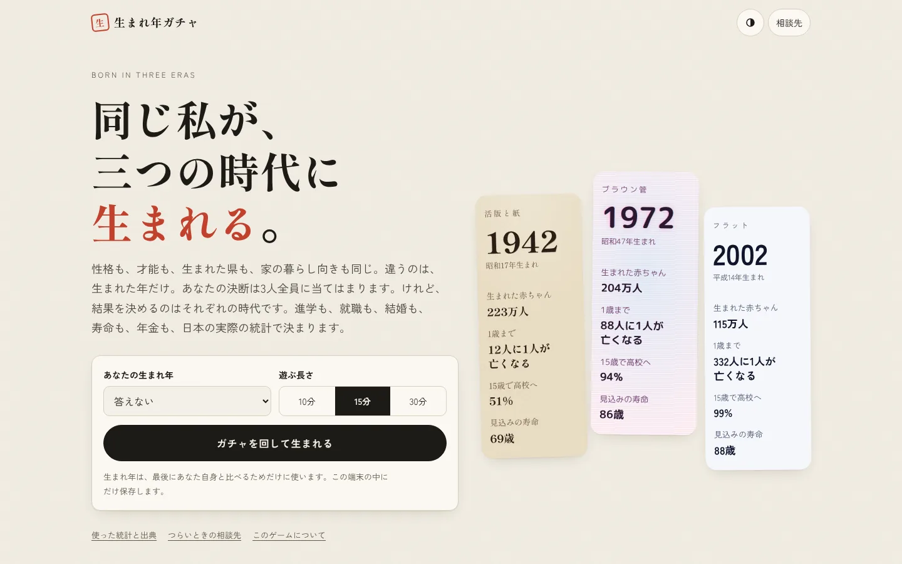 |
| 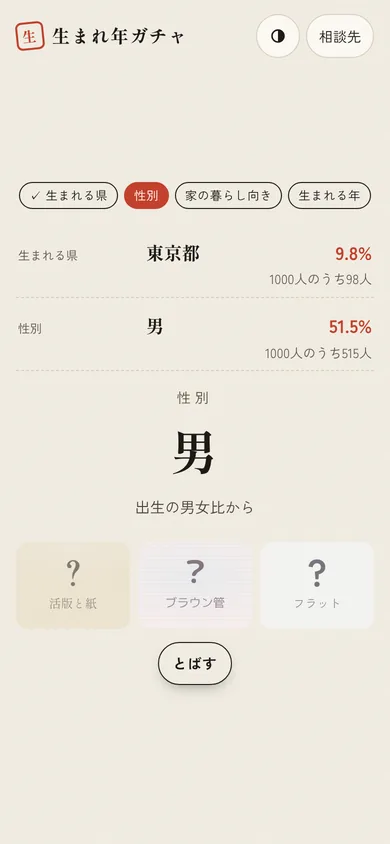 | 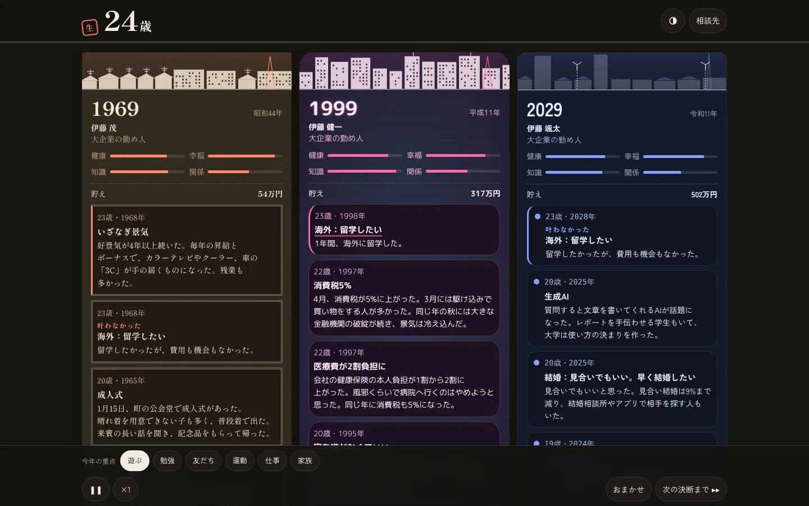 |
| 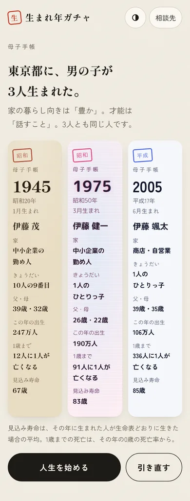 | 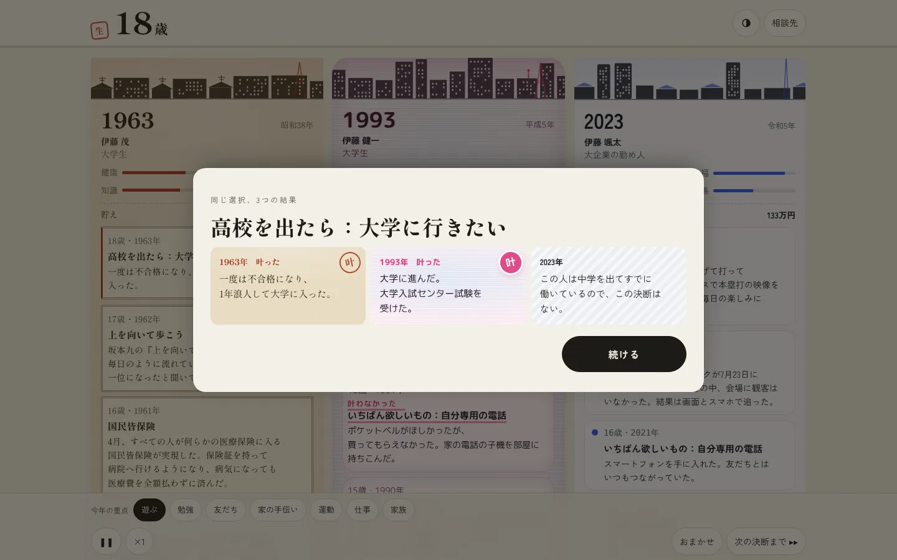 |
| 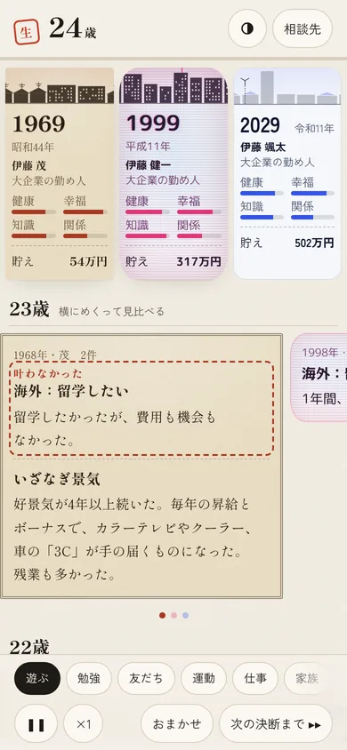 | 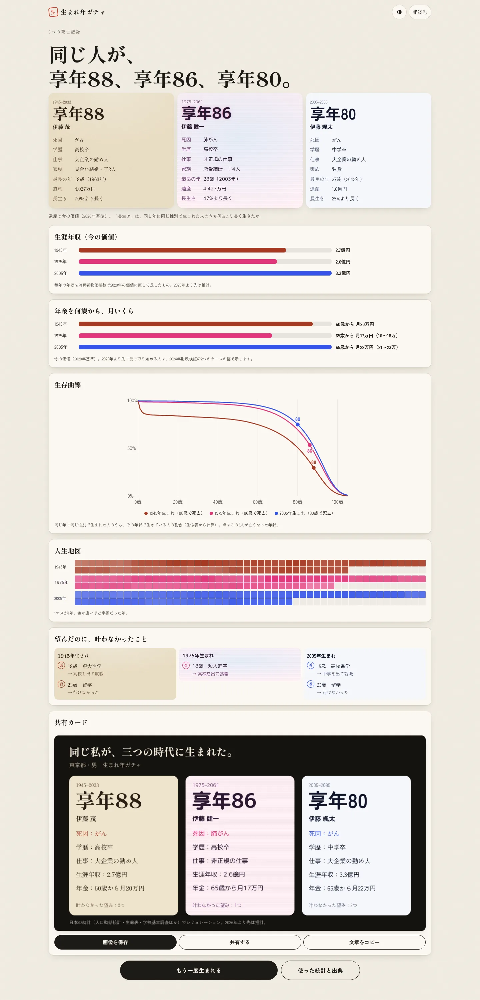 |
| 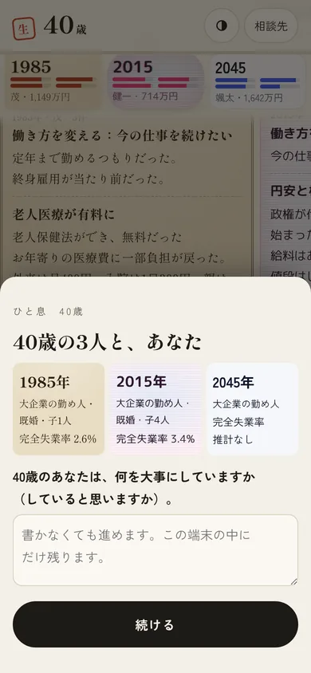 | |
| 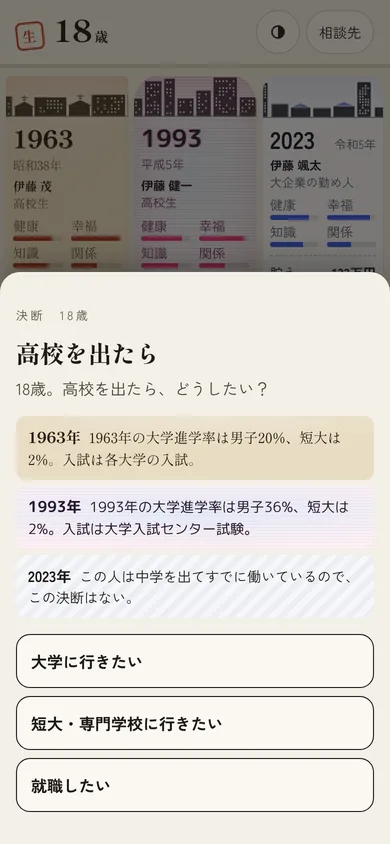 | |
| 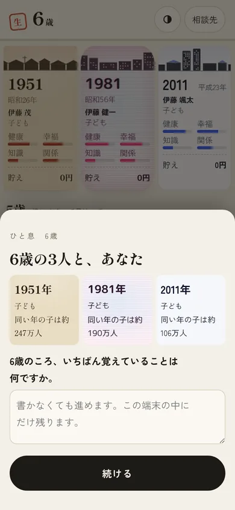 | |
| 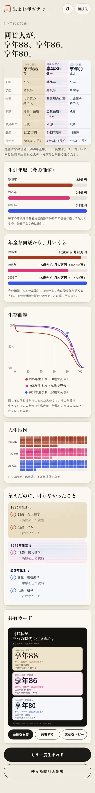 | |
| 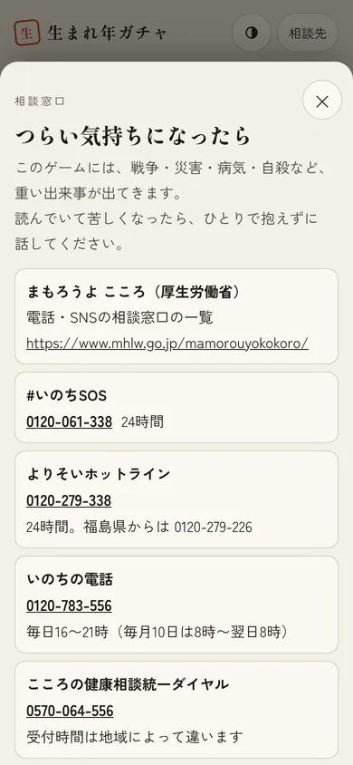 | |

## 4. 判断ログの要点

全文は docs/判断ログ.md にあります。主なものは次のとおりです。

1. **技術**：Vite + TypeScript（フレームワークなし）、Vitest、Playwright
2. **日本版死亡データベース（JMD）を使わない**：再配布の可否が不明なため。死亡率は、社人研の将来生命表（2020〜2070年）、厚労省の生命表（1995〜2019年）、社人研『人口統計資料集』の平均余命と乳児死亡率から復元した表（1930〜1994年）で作った。平均寿命は公表値と最大0.24年の差
3. **元データはコミットしない**：data/raw/ は .gitignore。加工後の JSON と加工スクリプトだけを置く
4. **WebSearch の上限**：作業の途中で、このセッションの WebSearch の回数上限に達した。その後は公式サイトの既知のURLを直接開いた範囲だけで確かめ、確かめられないものは「未確認」（verified: false）として進めた
5. **沖縄は外さない**：1944〜72年の出生数は人口と全国の出生率から推計。乳児死亡率や進学率は全国の値で代える。アメリカ統治下の沖縄で「都会へ出る」を選ぶと、渡航の証明書が要ったことを理由に出す
6. **名前**：明治安田生命のランキングは転載に許諾が要るため写さず、時代によく見かけた一般的な名前を数個ずつ置いた
7. **死亡率の倍率**：健康の数値は年齢ごとの平均からのずれだけを効かせ、喫煙・暮らし向きの倍率は平均がほぼ1になるようにした（生命表にある影響を二重に数えない）
8. **未来の賃金**：物価を2025年で止め、実質で年1.1%の伸び（2024年財政検証の前提の中間）
9. **スマホの人生画面**：3列は要約だけにし、出来事は同い年ごとに横幅いっぱいのカードで、横にめくって見比べる形にした（1列約118pxでは本文が読めないという講評を受けて）

## 5. 決めていただきたいこと

1. **JMD（社人研）に、加工した値を公開リポジトリに置いてよいか問い合わせるか**。今は使っていません。使えると、1947年以降の死亡率が都道府県別・毎年の実測になり、精度が上がります
2. **明治安田生命に、名前のランキングの利用を問い合わせるか**。今は一般的な名前を数個ずつ置いているだけです
3. **出来事の出典の水準**：都道府県の出来事243件のうち約160件は、ウィキペディア日本語版で年月日・数字を照合しています。公開前に一次資料（気象庁、各県の公式資料など）で確かめ直すかどうか
4. **重い出来事の確率**：空襲・原爆・沖縄戦の死亡確率は「死者数÷その県の人口」などから置いた目安です（各件の probNote に根拠）。ゲームとして重すぎないか、軽すぎないか、遊んで確かめていただきたいです
5. **遊ぶ長さ**：15分を標準にしましたが、決断21回とひと息5回を入れると、実際にはもう少しかかります。決断の数を減らすか
6. **仮称のままの名前**：「生まれ年ガチャ」で進めています
7. **main へのマージ**：下の「8.」の手順で PR を作るかどうか

## 6. 残った課題

**統計**
- 1980年前後の賃金の年齢カーブがない（2000年と2020年の形を、賃金の水準で伸び縮みさせている）
- 1953年より前の失業率、1963年より前の有効求人倍率、1970〜2001年の中卒・高卒の求人倍率がない
- 1937〜46年の物価と賃金は補間で、戦中のインフレを表せていない
- 琉球政府の統計（復帰前の沖縄の出生・死亡・進学）は紙の資料にしかなく、取れていない
- 1985年より前の預金金利は日本銀行の時系列統計に見つからず、目安で置いている
- e-Stat API のアプリケーションIDを登録すれば、都道府県別の進学率・県外進学などを取りに行ける

**シミュレーション**
- 都道府県による違いは、出来事と生まれる県の重みだけ。進学率・賃金・死亡率は全国の値を使っている
- 在職老齢年金、遺族年金、繰上げ・繰下げの細かい率は扱っていない（繰上げ0.76倍、繰下げ1.42倍の目安）
- 親の学歴・暮らし向きと子の進学の関係は、統計ではなく目安の倍率
- 「家の格」を時代の就業構造で読み替える部分は、都道府県別の産業構成を使っていない

**画面**
- 最後の講評で残った指摘：PCの人生画面で同じ年齢の出来事を1枚にまとめていない（スマホはまとめている）、PCの共有カードのプレビューが大きい、ガチャで大きな文字と結果の行に同じ文字が2回出る
- 走馬灯は文章のスライドだけで、絵がない
- 「実験室」は Vitest のテストとしてだけあり、画面はない
- 手紙・みんなの人生（サーバーが要る機能）は未着手（構想どおり公開後）
- BGM はない。効果音は最初は消音

**検証**
- 出来事の約1割（90件）は「未確認」（verified: false）。WebSearch の上限のため
- 実際の端末（iPhone・Android）では確かめていない（Playwright のヘッドレスのみ）

## 7. ファイルの地図

| 場所 | 中身 |
|---|---|
| src/sim/ | シミュレーション（engine.ts＝1年の進め方・死亡・就職・年金、decisions.ts＝決断、stats.ts＝統計の読み込み、events.ts＝出来事の読み込み、lab.ts＝実験室） |
| src/main.ts | 画面の流れ（タイトル→ガチャ→母子手帳→人生→最後） |
| src/ui/ | 町並み、共有カード、相談先と出典、効果音 |
| data/stats/ | 統計の JSON と出典（SOURCES_*.md、README_mortality.md） |
| data/events/ | 出来事の JSON（形式は docs/04） |
| scripts/ | 統計の加工（build_*.py）、スクリーンショット、E2E |
| tests/ | 実験室、同じ選択と3つの結果、通しの1回 |
| docs/ | 調査・カタログ・判断ログ・品質チェック・出典一覧・この報告 |

## 8. main へのマージ方法

作業はすべて `claude/awesome-gates-1wrnmu` ブランチに commit・push 済みです。main へは PR（プルリクエスト）を作ってマージします。

**GitHub の画面で行う場合**
1. https://github.com/isitest1/game_history を開く
2. 「Compare & pull request」（または Pull requests → New pull request）を押す
3. base を `main`、compare を `claude/awesome-gates-1wrnmu` にする
4. タイトルと説明を書き、「Create pull request」を押す
5. 差分を確かめて「Merge pull request」を押す

**コマンドで行う場合**（GitHub CLI がある環境）
```bash
gh pr create --base main --head claude/awesome-gates-1wrnmu --title "通しで遊べる試作版（夜間作業）" --body-file docs/夜間作業レポート.md
gh pr merge --merge
```

ご指示があれば、私が PR を作ることもできます。
